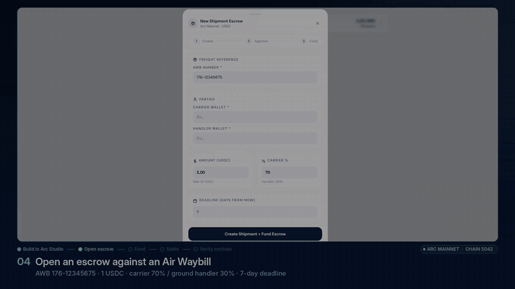

<div align="center">



### Air freight paid on delivery, in seconds. Not on a 30-day invoice cycle.

[](https://aircargowallet.netlify.app)
[](https://explorer.arc.io/address/0xb56Aea1AB82aA8f675Eb2FA59D418734046cD92F)
[](https://youtu.be/2kuF6uMZmrI)
[](https://studio.arc.io/app/1c925a33-8236-43f6-9886-d5bf8c83d152)
[](LICENSE)


</div>

> **Live on Arc mainnet with real USDC.** Shipment #3 escrowed **1 USDC** for AWB `176-12345675`, then paid **0.70 USDC** to the carrier and **0.30 USDC** to the ground handler. The contract ended back at **0**. Every step is public on [explorer.arc.io](https://explorer.arc.io/address/0xb56Aea1AB82aA8f675Eb2FA59D418734046cD92F). Contract, tests, deployment and app were all built in [Arc Studio](https://studio.arc.io/app/1c925a33-8236-43f6-9886-d5bf8c83d152).

---

## Why

Air cargo is settled on credit. A forwarder ships today, the carrier invoices, and payment lands roughly 30 days later through billing cycles and bank wires. Capital sits idle, reconciliation is manual, and the smallest parties carry the cost.

CargoWallet moves the settlement leg onchain. The forwarder locks USDC per Air Waybill when the cargo is booked. When the cargo is delivered, the carrier and the ground handler are paid **in seconds** at the split agreed upfront. If it is not delivered by the deadline, the forwarder gets the money back. No correspondent bank, no 30 days.

## Mainnet proof

| | |
|---|---|
| **Network** | Arc Mainnet (chain ID `5042`) |
| **Contract** | [`0xb56Aea1AB82aA8f675Eb2FA59D418734046cD92F`](https://explorer.arc.io/address/0xb56Aea1AB82aA8f675Eb2FA59D418734046cD92F) |
| **Deploy tx** | [`0x9a57fc6f…94505165`](https://explorer.arc.io/tx/0x9a57fc6f570174e26565f589aef64e74d4e2c71352a84d096947560094505165) |
| **Example tx: `fund()`, 1 USDC into escrow** | [`0x15dbb1fe…75afbf1f`](https://explorer.arc.io/tx/0x15dbb1feee30a26363ef7e9451becda55d30d2bad69b476fe04c740975afbf1f) |
| **Settlement** | 1 USDC in → 0.70 carrier + 0.30 handler claimed → contract balance 0 |
| **Owner** | `0x72454f65aAe03333E309084D5f211AC059212187` (hardware wallet; cap + pause only) |
| **USDC** | `0x3600000000000000000000000000000000000000` (6 decimals) |

## Demo

<div align="center">


Full walkthrough (Arc Studio build + mainnet transactions): **[youtu.be/2kuF6uMZmrI](https://youtu.be/2kuF6uMZmrI)**
</div>

## How it works



1. **Create.** The forwarder calls `createShipment` with the AWB reference (stored as `keccak256(awbNumber)`, never as plaintext), the carrier and handler addresses, the split in basis points, the amount and a deadline.
2. **Fund.** The forwarder approves USDC and calls `fund`. The USDC is locked in the contract.
3. **Delivered.** The forwarder calls `confirmDelivery`. The contract credits each party's claimable balance at the agreed split.
4. **Paid.** Carrier and handler each call `claim` and receive their USDC immediately.
5. **Not delivered?** After the deadline the forwarder calls `refund` and gets the full amount back. A shipment can also be cancelled before it is funded.

## Architecture

```
                         Arc Mainnet (chain 5042)
 ┌───────────────────────────────────────────────────────────────────┐
 │                                                                   │
 │   Forwarder ──createShipment / fund──▶  AirCargoEscrow.sol         │
 │      ▲                                  ├─ Shipment state machine │
 │      │ refund (after deadline)          │  Created → Funded →     │
 │      └──────────────────────────────────┤  Released | Refunded |  │
 │                                         │  Cancelled              │
 │                                         ├─ claimable[address]     │
 │   Carrier  ◀──────── claim() ───────────┤  (pull payments)        │
 │   Handler  ◀──────── claim() ───────────┤                         │
 │                                         ├─ ReentrancyGuard        │
 │                                         ├─ Ownable2Step           │
 │                                         │  (cap + pause only)     │
 │                                         └─ SafeERC20 ─▶ USDC      │
 │                                             0x3600…0000 (6 dec)   │
 └───────────────────────────────────────────────────────────────────┘
                                   ▲
                                   │ wagmi / viem (wallet provider first,
                                   │ public RPC fallback)
 ┌─────────────────────────────────┴─────────────────────────────────┐
 │  React app (Vite, Netlify): aircargowallet.netlify.app            │
 │  ├─ EscrowPanel: create → approve → fund (receipt-gated steps)    │
 │  ├─ Shipment list: status, split, deadline, explorer links        │
 │  ├─ Claims: carrier / handler pull their balance                  │
 │  └─ WireDocument: printable settlement proof per payment          │
 └───────────────────────────────────────────────────────────────────┘
```

## Tech stack

| Layer | Tools |
|---|---|
| Contract | Solidity 0.8.28 · OpenZeppelin 5.1 (`SafeERC20`, `ReentrancyGuard`, `Ownable2Step`) |
| Testing and analysis | Foundry (62 unit tests incl. fuzz + reentrancy) · Slither · mainnet-fork rehearsal on real Arc USDC |
| Chain | Arc Mainnet, USDC as the settlement asset and gas token |
| Frontend | React 18 · Vite 6 · TypeScript · Tailwind · wagmi v2 + viem · ConnectKit |
| Hosting | Netlify |
| Build | Arc Studio (contract, review, tests, deploy, app) |

## Smart contract

`contracts/AirCargoEscrow.sol`

| Function | Caller | What it does |
|---|---|---|
| `createShipment(awbRef, carrier, handler, carrierBps, handlerBps, amount, deadline)` | Forwarder | Opens an escrow in `Created` state |
| `fund(shipmentId)` | Forwarder | Pulls USDC into the contract (`Funded`) |
| `confirmDelivery(shipmentId)` | Forwarder | Credits carrier and handler (`Released`) |
| `claim()` | Carrier / Handler | Withdraws the caller's credited USDC |
| `refund(shipmentId)` | Forwarder | Returns the full amount after the deadline (`Refunded`) |
| `cancel(shipmentId)` | Forwarder | Cancels before funding (`Cancelled`) |
| `setMaxAmount(newMax)` | Owner | Per-shipment cap (10 USDC at launch) |
| `setPaused(bool)` | Owner | Pauses **new** `createShipment` / `fund` only |

Delivery credits balances instead of pushing transfers, so a blocklisted or broken recipient can never freeze the other party's payout:

```solidity
function confirmDelivery(uint256 shipmentId) external nonReentrant {
    Shipment storage shipment = shipments[shipmentId];
    if (shipment.status != Status.Funded) revert WrongStatus();
    if (msg.sender != shipment.forwarder) revert NotForwarder();

    shipment.status = Status.Released;

    uint256 carrierAmt = (shipment.amount * shipment.carrierBps) / 10_000;
    uint256 handlerAmt = shipment.amount - carrierAmt;

    claimable[shipment.carrier] += carrierAmt;
    claimable[shipment.handler] += handlerAmt;

    emit Released(shipmentId, carrierAmt, handlerAmt);
}

function claim() external nonReentrant {
    uint256 amount = claimable[msg.sender];
    if (amount == 0) revert NothingToClaim();
    claimable[msg.sender] = 0;
    usdc.safeTransfer(msg.sender, amount);
    emit Claimed(msg.sender, amount);
}
```

### Trust model

- **Forwarder-controlled lifecycle.** Only the shipment's forwarder can fund, confirm, refund or cancel it. Delivery confirmation is forwarder-only by design (no oracle yet; see Roadmap).
- **The owner cannot touch funds.** There is no withdraw, sweep or rescue function. Owner powers are limited to the per-shipment cap and pausing new escrows.
- **Users can always exit.** `confirmDelivery`, `claim`, `refund` and `cancel` work even while paused.
- **Safe ownership transfer.** `Ownable2Step` means the new owner must accept, so a mistyped address cannot lock the contract.
- **Immutable.** No proxy, no upgrade path.

### Security and testing

- Arc Studio security review: **0 critical / 0 high** after fixes. The review caught that pushing USDC to two recipients in one call could brick a shipment if either address was blocklisted. Fixed with pull payments.
- **62/62 Foundry tests**: happy path, every revert path, fuzzed split arithmetic, reentrancy attempt, pause scope, two-step ownership, deadline at funding time, basis-point overflow.
- **Slither**: one false positive (`arbitrary-send-erc20`, guarded by `msg.sender == forwarder`), two low timestamp notes (acceptable on Arc), one naming note.
- **Mainnet-fork rehearsal** of create → fund → confirm → claim → refund against the real Arc USDC before going live.

> Reviewed by Arc Studio's automated pipeline, not by an external auditor. Amounts are capped at 10 USDC per shipment until an external audit is done.

## Local development

Prerequisites: [Bun](https://bun.sh) and [Foundry](https://book.getfoundry.sh).

```bash
git clone https://github.com/Makabeez/cargowallet.git
cd cargowallet
bun install          # app deps + @openzeppelin/contracts (remapped from node_modules)
forge test           # 62 contract tests (lib/forge-std is vendored)
bun run dev          # app at http://localhost:5173, connects to Arc mainnet
```

Other scripts: `bun run build` (production build), `bun run typecheck`, `bun run lint`, `bun run check` (lint + typecheck).

## Deployment

The contract was deployed from Arc Studio to Arc mainnet with constructor args `(USDC, owner)`:

```text
usdc  = 0x3600000000000000000000000000000000000000
owner = 0x72454f65aAe03333E309084D5f211AC059212187
```

Arc Studio first ran a fork verification (`--mode verify`) against real Arc USDC, then deployed live with a throwaway deployer key holding about 1 USDC for gas. That key has no privileges after deployment: the owner is a hardware wallet. The deploy scripts are in `scripts/` (`compass-deploy.ts`, `self-deploy.ts`), and deploy metadata is in `contracts/contract-metadata/AirCargoEscrow.json`. `compass-deploy.ts` depends on Circle's Compass packages, which are only available inside the Arc Studio sandbox, so it is excluded from the local typecheck.

The app is a static Vite build hosted on Netlify. The contract address is a committed constant in `src/lib/chain.ts`, and the ABI is generated from the compiler artifact (`src/lib/escrowAbi.ts`).

## Roadmap

- **CHF settlement** for Swiss forwarders, a one-line config switch once a CHF stablecoin is live on Arc
- **Invoicing integrations**: create escrows from existing air cargo billing and booking systems
- **Delivery attestation** by the handler or an oracle, instead of forwarder-only confirmation
- **Higher caps** after an external audit

## Built with Arc Studio

The project ([Arc Studio project](https://studio.arc.io/app/1c925a33-8236-43f6-9886-d5bf8c83d152)) was built in a single Arc Studio workspace:

- **Contract**: written, security-reviewed and fixed by Studio's contract pipeline
- **Tests**: 62 Foundry unit tests plus a mainnet-fork integration run
- **Static analysis**: Slither in the Studio sandbox
- **Deployment**: fork verification, then a live deploy to Arc mainnet
- **App**: React/Vite/wagmi frontend wired to the deployed contract, debugged live (event decoding from the compiler ABI, tested against real mainnet logs)

Submitted to **Arc Microgrants: Built with Arc Studio**.

## Attribution

Built by **[Makabeez](https://github.com/Makabeez)** ([@GeiserJoe2](https://x.com/GeiserJoe2)) with [Arc Studio](https://studio.arc.io) by Circle. Uses [OpenZeppelin Contracts](https://github.com/OpenZeppelin/openzeppelin-contracts) and [forge-std](https://github.com/foundry-rs/forge-std).

## License

[MIT](LICENSE)
